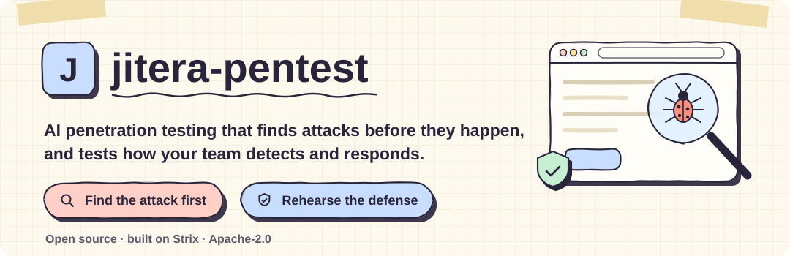
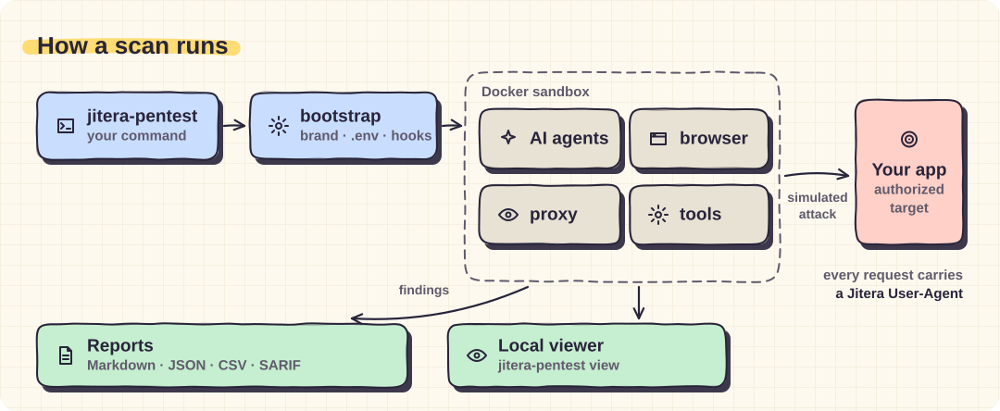
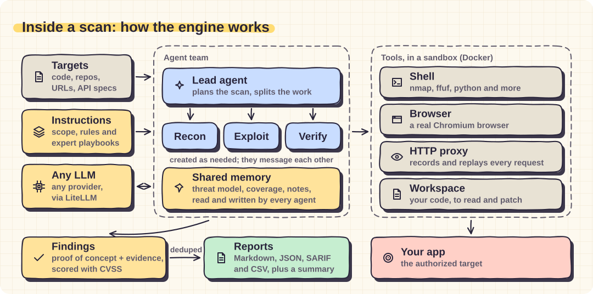
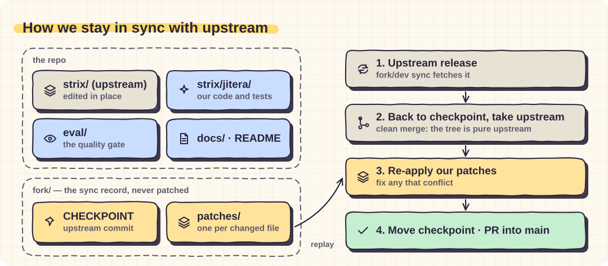
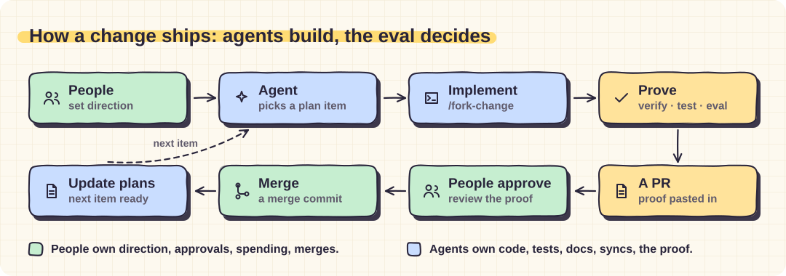

<p align="center">
  
</p>

# Jitera

AI penetration testing that finds attacks before they happen, and tests how your team detects and responds. Autonomous AI agents attack your code and running applications the way a real attacker would, through real browsers, and back each finding with a working proof of concept.

Jitera is built on [Strix](https://github.com/usestrix/strix) (Apache-2.0). It adds our brand and network identity, and turns off the upstream vendor's cloud services and telemetry. See [What's different from Strix](#whats-different-from-strix).

## What it does

- **Full pentesting toolkit** inside a Docker sandbox: HTTP interception proxy (Caido), browser automation, shell, Python exploit runtime, reconnaissance, static and dynamic analysis.
- **A team of agents**: specialised agents for recon, exploitation and validation work in parallel and share what they find.
- **Validated findings**: each comes with a proof of concept, a CVSS score and fix guidance.
- **Reports** in Markdown, JSON, CSV and SARIF.

<p align="center">
  
</p>

Inside a scan, a team of AI agents does the work:

<p align="center">
  
</p>

It covers the OWASP Top 10 and beyond: access control and IDOR, injection, SSRF, XXE and RCE, XSS and CSRF, business logic and race conditions, authentication and sessions, cloud misconfiguration, and API security.

Only test systems you are authorized to test.

## Requirements

- Docker, running
- Python 3.12+ and a recent [uv](https://docs.astral.sh/uv/). Older uv versions rewrite `uv.lock`, so always pass `--frozen`.
- Go 1.24+ for the interactive terminal UI. Headless mode (`-n`) works without it.
- An LLM: an API key for any [LiteLLM](https://docs.litellm.ai/docs/providers) provider, or a ChatGPT subscription

## Install

```bash
git clone git@github.com:Jitera-Context/jitera-penetration-testing-tool.git
cd jitera-penetration-testing-tool
uv sync --frozen
source .venv/bin/activate
cp .env.example .env      # then fill in your model and API key
jitera-pentest about
```

Prebuilt binaries will be published on this repository's releases once the release pipeline is in place.

## Quick start

Set your model and key in `.env` (copied from `.env.example`):

```bash
JITERA_PENTEST_LLM=openrouter/z-ai/glm-5.3   # any LiteLLM model id
LLM_API_KEY=your-api-key
```

Then scan:

```bash
jitera-pentest --target https://your-app.com
```

The command is `jitera-pentest` because `jitera` is the Jitera Gateway CLI. Use `jitera-pentest`, not `strix`: the `strix` command is still installed, but it runs upstream's branding and telemetry.

## Usage

```bash
# Local code, a GitHub repository, or a live app
jitera-pentest --target ./app-directory
jitera-pentest --target https://github.com/org/repo
jitera-pentest --target https://your-app.com

# An API contract plus the live base URL
jitera-pentest --target ./openapi.yaml --target https://api.your-app.com

# Authenticated (grey-box) testing
jitera-pentest --target https://your-app.com --instruction "Log in as user:pass before testing"

# Several targets, or a file of targets
jitera-pentest -t https://github.com/org/app -t https://your-app.com
jitera-pentest --target-list ./targets.txt

# Headless, for CI and servers: quick scan, capped spend, fail on high or worse
jitera-pentest -n --target ./ --scan-mode quick --max-budget 10 --fail-on high
```

Scan modes are `quick`, `standard` and `deep` (the default). In headless mode the exit code is `0` when no findings were reported, `1` on a fatal error, and `2` when findings were reported (with `--fail-on`, only findings at or above that severity count).

### Results

Each scan writes to `strix_runs/<run-name>/`:

| File | Contents |
|---|---|
| `penetration_test_report.md` | The full report |
| `vulnerabilities/*.md` | One file per finding |
| `vulnerabilities.json` | All findings, machine-readable |
| `findings.sarif` | SARIF 2.1.0 for code-scanning tools |
| `run.json` | Status, timing and LLM cost |

Open them in the local viewer:

```bash
jitera-pentest view                # most recent run
jitera-pentest view my-run-name    # a specific run
```

### Other commands

```bash
jitera-pentest about                 # version and attribution
jitera-pentest auth login chatgpt    # run on a ChatGPT subscription instead of an API key
jitera-pentest --resume my-run-name  # continue a stopped scan
jitera-pentest completions zsh       # shell completion (bash and fish too)
```

## Configuration

Put settings in `.env` at the root of this checkout. [`.env.example`](.env.example) lists the common ones with explanations. `jitera-pentest` reads that file on every run, from any folder:

- Variables already set in your shell win over the file.
- Empty values in the file are ignored.
- `.env` is git-ignored, so keys are never committed.
- It never reads the `.env` of the folder you run it in. That's usually the project you're scanning, which may hold unrelated keys.
- To keep the file somewhere else (for example with the packaged binary), set `JITERA_PENTEST_ENV_FILE=/path/to/file` in your shell.

Every upstream `STRIX_*` setting works. You can also write it as `JITERA_PENTEST_*`, and the `jitera-pentest` command copies it to the `STRIX_*` name.

| Variable | Purpose |
|---|---|
| `JITERA_PENTEST_LLM` | Model id, for example `openrouter/z-ai/glm-5.3` |
| `LLM_API_KEY` | API key for that provider |
| `LLM_API_BASE` | Base URL for a local model (Ollama, LM Studio) |
| `PERPLEXITY_API_KEY` or `EXA_API_KEY` | Optional web search for the agents |
| `JITERA_PENTEST_IMAGE` | Sandbox image. Default: upstream's `ghcr.io/usestrix/strix-sandbox:1.4.1` |

The tool also remembers settings in `~/.strix/cli-config.json`; your shell and `.env` win over it. To give the agents extra tools, list MCP servers in `~/.strix/mcp-servers.json`. The [upstream documentation](https://docs.strix.ai/) describes every option.

## What's different from Strix

| | Strix | Jitera |
|---|---|---|
| Command | `strix` | `jitera-pentest` |
| User-Agent of our own calls | `python-requests/…` | `Jitera/<version> (+https://jitera.com)` |
| User-Agent of scan traffic | A generic Chrome browser | `Mozilla/5.0 (compatible; Jitera/<version>; +https://jitera.com)` on proxy replays, the sandbox browser, and requests the agent writes |
| Telemetry | On, sent to Strix | Off by default |
| `cloud` and `--update` | Strix Cloud and self-update from Strix releases | Blocked |
| Viewer | Strix Cloud upsells, email and feedback relays | Hidden |
| CLI, terminal UI, reports, viewer | Strix | Jitera |

Customers can recognize our authorized scan traffic by its User-Agent.

## Eval: OWASP Juice Shop

Checks that the scanner still finds what it should, on [OWASP Juice Shop](https://owasp.org/www-project-juice-shop/), a deliberately vulnerable app OWASP publishes for this purpose. The eval uses the same `.env` as the tool.

```bash
cp .env.example .env                              # once: set JITERA_PENTEST_LLM and LLM_API_KEY
fork/dev eval --check                             # target up and model set? No scan, no cost
fork/dev eval                                     # scan, score, pass or fail (takes a while, costs LLM credit)
fork/dev eval --scan-mode quick --max-budget 5    # a cheaper run
fork/dev eval-history                             # recent runs: coverage, gate, result
```

A run passes when its findings cover at least 6 of the 12 vulnerability categories in [`eval/baseline/juice-shop.yaml`](eval/baseline/juice-shop.yaml). Each run is recorded in `eval/results/`.

| Exit code | Meaning |
|---|---|
| `0` | Pass |
| `1` | Regression: below the gate |
| `2` | Setup problem, for example no model configured |
| `3` | Target down |

If the public demo is down, run Juice Shop locally and point the eval at it:

```bash
docker run --rm -p 3000:3000 bkimminich/juice-shop:v20.4.0
fork/dev eval --target http://localhost:3000
```

To improve the agent's instructions with [GEPA](https://pypi.org/project/gepa/), start with a dry run. A real run does a full scan for every step, so it's slow and costs LLM credit.

```bash
fork/dev gepa --dry-run                 # check the setup: no scans, no cost
fork/dev gepa --max-metric-calls 6      # real optimization
```

[`eval/README.md`](eval/README.md) has the details. In Claude Code, `/eval-run` and `/eval-gepa` run these for you and ask before anything that costs money.

## Documentation

| Folder | What's in it |
|---|---|
| [`docs/visions/`](docs/visions/README.md) | Detect attacks before they happen, and rehearse how defenders respond: goals, principles, open questions |
| [`docs/architecture/`](docs/architecture/README.md) | How it's built to scale and stay in sync with upstream; every feature must pass the eval; agents lead development and prove every change |
| [`docs/plans/`](docs/plans/README.md) | What's done, what's next, and open decisions |

## Developing

This repository is a fork kept easy to sync with upstream:

- Edit the source directly. Our own code lives in `strix/jitera/`, our tests in `tests/jitera/`.
- `fork/dev save` records every change since the upstream checkpoint (`fork/CHECKPOINT`) as patches in `fork/patches/`. Commit the code and its patches together.
- `fork/dev sync` takes a new upstream: back to the checkpoint, remove our changes, take the latest upstream, re-apply the patches.

<p align="center">
  
</p>

Development is led by AI agents and gated by the eval: agents build and prove each change, people approve.

<p align="center">
  
</p>

```bash
fork/dev help       # every command
fork/dev status     # checkpoint, how far upstream moved, patches out of date
fork/dev test       # brand audit, lint, type check, tests
```

`fork/dev` works from any folder. For the eval commands, see [Eval: OWASP Juice Shop](#eval-owasp-juice-shop).

The full guide with diagrams is [`fork/architecture.html`](fork/architecture.html). In Claude Code, use `/fork-change`, `/fork-sync`, `/eval-run` and `/eval-gepa`.

## License

Apache-2.0. Built on [Strix](https://github.com/usestrix/strix) by the Strix authors. See [LICENSE](LICENSE) and [NOTICE](NOTICE).
