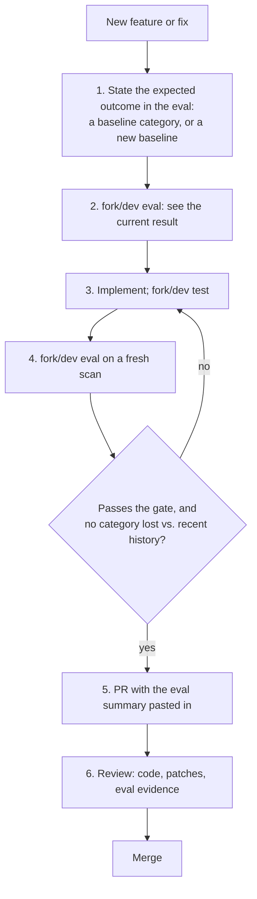

# Eval-driven development

**Every feature must pass the eval before it merges.** For an AI pentest
agent, tests can't tell us whether a change made the agent better or worse at
finding vulnerabilities. Only running it against a known target can. So the
eval, not the test suite alone, is our definition of done.

## The eval in one paragraph

`fork/dev eval` scans OWASP Juice Shop (a deliberately vulnerable app OWASP
publishes for this purpose) with the real agent, maps each finding to the
vulnerability categories in `eval/baseline/juice-shop.yaml`, and passes when at
least `min_categories` are covered. It counts categories rather than findings
because an AI agent words and orders findings differently every run; the set
of vulnerability classes it finds is stable. Each run is recorded in
`eval/results/`. Details: [`eval/README.md`](../../eval/README.md).

## Which changes need the eval

| Needs a passing eval | Doesn't |
|---|---|
| Agent prompts and instructions | Docs (`docs/`, READMEs) |
| Skills (pentest knowledge) | `fork/` tooling and `.claude/` skills |
| Agent tools and the scan flow | Tests only |
| Runtime, sandbox, proxy, browser | CI configuration |
| LLM settings, model defaults, budgets | |
| Brand or User-Agent changes that reach scan traffic | |
| **Every upstream sync** | |

When in doubt, run it.

## The development loop

1. **State the expectation first.** If the feature should find a new class of
   vulnerability, add that category to the baseline, or add a new baseline and
   target for it. If it shouldn't change coverage, the existing gate is the
   expectation.
2. **Measure before you change.** A run before the change shows what "better"
   means.
3. **Implement**, with `fork/dev test` passing.
4. **Run the eval on a fresh scan.** `fork/dev eval --check` first confirms the
   target is up and a model is configured.
5. **Open the PR with the evidence:** the summary `fork/dev eval` prints
   (coverage, gate, missed categories) and the scan mode and cost. Most changes
   here are made by agents, and this evidence is how they prove their work
   ([agent-led development](agent-led-development.md)).
6. **Review checks the evidence** as well as the code, using the
   [PR template](../../.github/pull_request_template.md) checklist.

## Pass and fail

- **Pass:** exit code `0`, so coverage is at or above `min_categories`, **and**
  no category that recent runs consistently found is now missed
  (`fork/dev eval-history`).
- **Variance:** an AI agent varies run to run. On a borderline failure, run once
  more; two failures in a row is a regression.
- **Not a regression:** exit code `3` (the target is down) or a scan that
  stopped early on budget or rate limits (check the run's `run.json`). Fix the
  run, not the code.

## Managing the gate

- **Calibrate first.** `min_categories: 6` of 12 is a provisional starting
  value. After about three real runs, set it a little below the typical
  coverage.
- **Ratchet up, never down.** When coverage stays higher for a while, raise the
  gate so we keep the gain. Lowering it needs its own PR explaining why, never a
  feature PR that happens to fail.
- **Grow the baseline with the product.** New capabilities bring new
  categories or new targets (`eval/baseline/<name>.yaml`).

## Cost

A real scan takes minutes to hours and spends LLM credit, so match the scan to
the moment:

| When | Scan | Typical command |
|---|---|---|
| While developing | Quick, small budget | `fork/dev eval --scan-mode quick --max-budget 5` |
| Before merging a feature | The baseline's settings | `fork/dev eval` |
| Release, and after each sync | The baseline's settings, repeated | `fork/dev eval`, then `fork/dev eval-history` |
| Re-checking a finished run | No scan | `fork/dev eval --from-run DIR` |

## Improving the agent with GEPA

GEPA proposes better agent instructions by running the eval, reflecting on the
categories a scan missed, and rewriting the instructions. Its output is a
candidate like any other: it's adopted only when the eval shows it does better
across repeated runs. `/eval-gepa` walks through dry run, cost approval, the
real run and validation.

## Enforcement today and next

| Today | Next (see [plans](../plans/README.md)) |
|---|---|
| The PR template's eval checklist, checked by reviewers | A CI job that runs a quick eval on PRs that touch agent behavior |
| `fork/dev eval-history` as the record | Nightly full eval on `main`, with results kept as build artifacts |
| The gate is provisional (6 of 12) | The gate calibrated from real runs |
